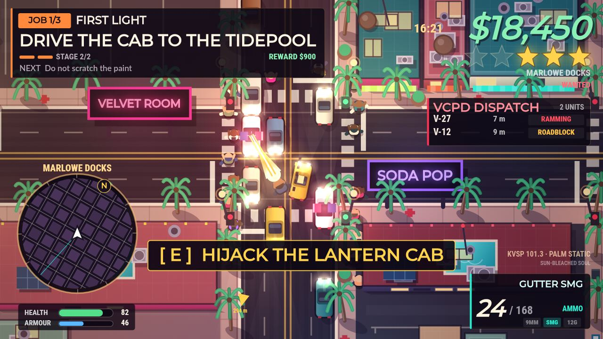

# Vesper City — Sunset Syndicate

Vesper City — Sunset Syndicate is a top-down open-world crime game in an original neon coastal city: nine districts of streets, boardwalk and beach, with traffic that flows, crowds on the pavements, cars you can steal, gunplay on foot and from the driver's seat, and a five-star wanted level that brings the Vesper City Police Department after you. Three story jobs — steal a cab, shake down the boardwalk, then run a ledger to Salt Airfield — pay cash, and the HUD keeps the minimap, wanted stars, mission objective, speedometer and radio on screen while you walk or drive.

Nia Torres and Jax Mercer follow on foot and ride in your car. Press `C` to call or dismiss them. Press `V` to start or cancel a street race, then drive through each glowing checkpoint to earn $2,500. The HUD shows your crew, the next checkpoint and the race timer.

The game is plain static files under `game/`: one HTML page and its ES modules, no build step, no library and no network request, so any static server plays it offline. `main.ts` (Node 22, standard library only) hands it in: it copies `game/` and `screenshots/` to `/output` and writes `/output/dossier.json` with `buildDossier` from `vendor/makefun-game.ts`, the kit's library unchanged. Play it locally with `node serve.ts` and open http://localhost:8080, or build the hand-in with `MAKEFUN_OUTPUT_DIR=out node main.ts`.

